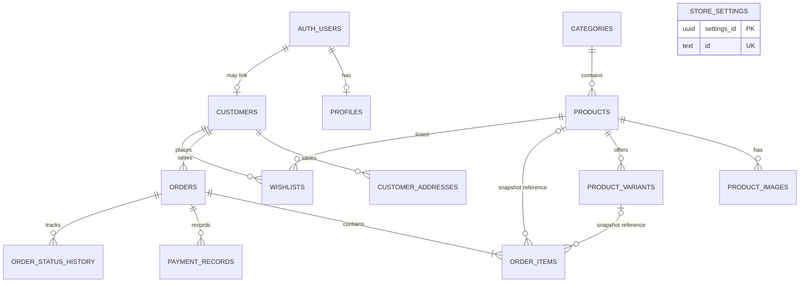

# Supabase database reference

This database uses Supabase PostgreSQL, Auth, and Storage. Migration `202611120001_initial_schema.sql` establishes the API's original schema; `202611120002_normalized_store_schema.sql` adds the normalized customer, variant, image, payment, and history structures. The second migration keeps compatibility columns used by the currently deployed Express API while synchronizing them with the normalized fields. Apply both migrations in order.

## Entity relationships



`AUTH_USERS` is Supabase's `auth.users` table. Product/order references are retained with `ON DELETE SET NULL` on order items; item name, image, size, colour, and price snapshots remain available if a referenced product or variant is removed. Products are normally archived rather than deleted.

## Tables

| Table | Purpose and important constraints |
|---|---|
| `profiles` | Auth-linked display/contact data and trusted `admin`/`customer` role. New users receive `customer` regardless of user metadata. |
| `categories` | Unique slug, description, image, active state, and display order. Legacy `image`, `visible`, and `sort_order` columns remain synchronized. |
| `products` | Unique slug/SKU, positive price, valid optional discount, active/featured flags and searchable catalogue data. Legacy `images`, `sizes`, `colors`, and `stock` remain available to the API. |
| `product_images` | Ordered product images with URL and optional storage path; deleting the product removes these catalogue records. |
| `product_variants` | Unique `(product_id, size, colour)` and SKU, non-negative per-variant stock, active flag. Catalogue options create variants; initial product stock is divided across those combinations. Variant stock is the source of truth when variants exist, and `products.stock` is maintained as their active total. |
| `customers` | Optional Auth link, contact details, and support for guest customer records. |
| `customer_addresses` | Saved customer addresses with a partial unique index permitting at most one default address per customer. |
| `orders` | Unique generated order number, customer/address/note snapshots, totals, payment status, and order status. Guest orders have no Auth link; the customer snapshot remains. |
| `order_items` | Product and variant references are nullable; snapshots preserve historical item details. `discount_price` records the charged unit price only when discounted; `unit_price` is the authoritative charged unit price. |
| `payment_records` | Append-only payment/verification history; no card, UPI PIN, password, or payment credential fields. Verification records the trusted admin UUID. |
| `wishlists` | Normalized customer/product relation with unique `(customer_id, product_id)`. `wishlist_items` remains for compatibility with the current API. |
| `store_settings` | Public shop configuration. `settings_id` is the UUID primary key and legacy `id = 'main'` is unique for API compatibility. Currency is constrained to INR. |
| `order_status_history` | Status transitions with prior/new values, optional admin UUID and note. |
| `order_history` | Original API's broader history, including payment and admin-note events. |

The database stores normalized status values in `orders.order_status` (`pending_confirmation`, `payment_reported`, etc.) while retaining the original title-cased status columns consumed by the existing API. Database triggers keep both representations aligned.

## Security and RLS

RLS is enabled on every application table. `public.is_store_admin()` is a `SECURITY DEFINER` helper with a fixed search path; it checks `profiles.role` for `auth.uid()`. Only the trusted service role or an administrator can change profile roles—there is no self-service role-update policy.

- Anonymous/authenticated visitors can select active categories, active products, their active images/variants, and the public settings row.
- Authenticated users can read their own profile/customer record, addresses, linked orders/items/history, and wishlist. They cannot read another customer's personal/order data.
- Administrators can manage catalogue, inventory, customer, order, payment, history, wishlist, and settings records through RLS policies.
- No anonymous order or order-item insert policy exists. Guest checkout uses the Express service role to call the transactional order RPC.
- Guest tracking is performed by Express and must match both order reference and phone number; no RLS policy grants anonymous order reads.
- The service-role key bypasses RLS. Keep it only in the backend deployment secret store, never in `VITE_*` settings or a browser bundle.

## Storage

The migration creates public-read buckets `product-images`, `category-images`, `store-assets`, and `promotional-banners`. Each allows JPEG, PNG, and WebP files up to 5 MiB. Authenticated administrators can upload, update, and delete objects; anonymous/authenticated visitors can download public assets only. Use generated, non-reused object names and persist object paths with image records/settings so cleanup can identify the exact asset.

The initial API migration also creates the legacy `store-assets` bucket. The Express upload service currently targets that single bucket via `SUPABASE_STORAGE_BUCKET`; it uses the service role and performs MIME and file-signature validation. The additional buckets are ready for a future bucket-aware upload endpoint.

## Functions and triggers

- `handle_new_auth_user`: creates a customer-role profile and linked customer record from safe Auth fields; it never reads a requested role from user metadata.
- `touch_updated_at`: updates timestamps for profiles, customers, variants, and the original timestamped tables.
- Compatibility triggers synchronize the old API fields with normalized category, product, order, settings, and order-item snapshots.
- Product catalog triggers create/update variant combinations and ordered image rows. Removing a size/colour with positive variant stock is rejected.
- Variant stock triggers maintain aggregate `products.stock`; direct aggregate edits are rejected once variants exist.
- `create_store_order`: service-role-only transaction. It validates the request, locks product and variant inventory, calculates database prices and delivery, writes customer/address/item/payment snapshots, and decrements inventory atomically.
- `set_order_status`: service-role-only transaction. Cancellation restores variant or legacy stock only on the first transition to cancelled; delivered/cancelled transition rules are enforced.
- `set_order_payment_status`: service-role-only transaction. Writes an audit payment record and the trusted verifying admin UUID; verified records are rejected unless that UUID has the database `admin` role.
- Order history triggers record status changes. The generated unique order number is assigned in PostgreSQL, not by the frontend.
- `admin_store_overview`: service-role-only aggregate metrics for the admin dashboard.

## Indexes and search

Indexes cover unique category/product/order identifiers, product category and active/featured/price ordering, GIN variant sizes/colours, product variant lookup and stock, product images, trigram and full-text product-name/description/material search, customer phone/email, order customer/phone/date/status/payment lookups, order items/history/payment records, and wishlist customer/product lookups. PostgreSQL trigram search uses the `pg_trgm` extension in Supabase's `extensions` schema.

## Setup and migrations

1. Create a Supabase project and copy its project URL, anon key, and service-role key into the backend deployment environment. Do not copy the service-role key to the frontend.
2. Install and authenticate the Supabase CLI, then link the local project:

   ```powershell
   supabase login
   supabase link --project-ref YOUR_PROJECT_REF
   ```
3. Apply migrations in order:

   ```powershell
   supabase db push
   ```

   Alternatively, run both migration files in lexical order in the Supabase SQL editor.
4. Create/invite the first admin using Supabase Auth. Promote its trusted UUID from the SQL editor:

   ```sql
   update public.profiles set role = 'admin'
   where id = 'TRUSTED_AUTH_USER_UUID';
   ```
5. Configure the `main` settings row and create categories/products. Product size/colour arrays produce initial variants; set each variant's exact `stock_quantity` through a trusted admin workflow.
6. To load optional development examples, execute `supabase/seed.sql` in a development project only. It creates categories/products/settings and variants, but no customers or payments.

## Express connection

Set `SUPABASE_URL`, `SUPABASE_ANON_KEY`, and `SUPABASE_SERVICE_ROLE_KEY` in `backend/.env` locally or the server secret manager in deployment. `src/config/supabase.ts` creates separate clients: the anon-key client handles Auth sign-in/refresh, while the service-role client performs trusted database/RPC/storage operations. Configure `VITE_API_URL` to the Express `/api` URL; the browser talks to Express and never receives the service-role key.
